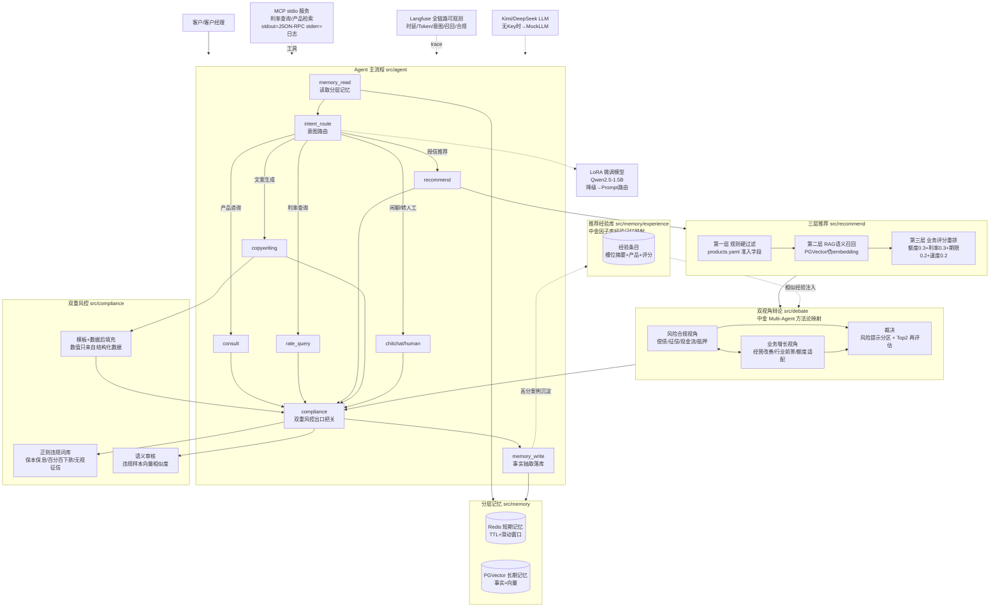

# credit-agent-platform · 智能信贷营销与咨询一体化 Agent 平台

面向商业银行信贷场景的智能 Agent 系统教学复现工程，覆盖 **产品咨询、利率查询、
授信推荐、营销文案生成** 全流程。对话六层（意图/槽位/推荐理由/文案模板/语义审核/
合规重写）全部为**真实提示词驱动**（`src/llm/prompts.py`），无 Key 时自动降级确定性逻辑。
技术栈：Python、LangChain、LangGraph、Kimi（Moonshot）/ DeepSeek、
LLaMA-Factory（LoRA）、PostgreSQL + PGVector、Redis、MCP、Langfuse。

> **零依赖可跑**：本工程的一条硬纪律是 —— 所有第三方包（langgraph / redis /
> psycopg / langfuse / torch …）的 import 全部放在函数内或 try/except 中，
> 未安装任何依赖、未配置任何外部服务时，`demo`、`pytest`、数据生成脚本依然
> 完整可跑，外部服务自动降级为内置 Mock（行为接口保持一致）。

## 核心实现与架构亮点

| # | 模块 | 实现要点 |
|---|------|----------|
| 1 | 三层产品推荐 | 槽位抽取（规则+LLM 双通道）→ 规则硬过滤 + RAG 语义召回 → 多维业务评分（额度/期限/利率/审批速度加权）+ 可选 LLM 重排 |
| 2 | 分层记忆 | Redis 短期会话记忆（TTL + 滑动窗口）+ PGVector 长期事实记忆（语义抽取 + 向量召回），跨会话留存客户画像 |
| 3 | 意图路由 | 1000 条业务对话数据 LoRA 微调 Qwen2.5-1.5B（LLaMA-Factory），教学复盘准确率 70%（Prompt 基线）→ 85%+；模型不可用时自动降级 Prompt 路由 |
| 4 | 双重风控文案 | 正则违规词库 + 语义相似度审核双闸拦截违规话术；模板 + 数据后填充机制从根上杜绝数值幻觉（LLM 不生成任何数字） |
| 5 | MCP 服务 | stdio JSON-RPC 工具服务（利率查询/产品检索），stdout 纯协议流、stderr 日志流严格隔离 |
| 6 | 可观测 | Langfuse 全链路 trace：意图识别、记忆检索、工具调用、LLM 推理的时延/Token/属性；未配置时 no-op + 内存 trace 摘要 |

## 系统架构



## 快速开始

环境要求：Python 3.10+（开发验证使用 3.12）。**以下三步均无需安装任何第三方包**
（pytest 除外，`pip install pytest` 即可）。

```bash
# 1) 端到端多轮对话演示（推荐/记忆/合规/幻觉对照全链路）
python src/demo.py

# 2) 单元测试（95 个用例，全部零外部依赖；另有 6 个真实 LLM 联调用例默认跳过）
python -m pytest tests/ -q

# 3) 生成 1000 条意图训练数据（仓库已附带生成结果）
python data/generate_intent_data.py
```

MCP 服务（原生 JSON-RPC 实现，零依赖）：

```bash
python -m src.mcp_server.server --selftest   # 自检：协议闭环 + stdout 无污染
python -m src.mcp_server.server              # 作为 stdio 服务运行，等待客户端
```

### 可选：接入真实外部服务

```bash
docker compose up -d                 # postgres+pgvector + redis
pip install -r requirements.txt      # 运行环境依赖（langgraph/redis/psycopg/langfuse…）
cp .env.example .env                 # 填入 KIMI_API_KEY（或 DEEPSEEK_API_KEY）、LANGFUSE_* 等
python scripts/seed_products.py      # 产品库灌库（含向量）
python src/demo.py                   # 同一套代码自动升级为真实后端
```

### 可选：LLM provider 配置（Kimi / DeepSeek）

五层对话能力由真实大模型驱动；不配置任何 Key 时自动降级 MockLLM（行为接口一致）。
provider 探测链：`LLM_PROVIDER`（auto/mock/kimi/deepseek）显式指定优先；
`auto` 下依次探测 `DEEPSEEK_API_KEY` → `KIMI_API_KEY`/`MOONSHOT_API_KEY` → Mock。

```bash
# .env 最小配置（Kimi for Coding 端点）
KIMI_API_KEY=sk-...
KIMI_BASE_URL=https://api.kimi.com/coding/v1   # 网关地址可省略 /v1，客户端自动补全
KIMI_MODEL=kimi-for-coding-highspeed   # 延迟最低档；追求极致稳定可换 kimi-for-coding
LLM_TEMPERATURE=1        # coding 端点仅允许 1；公共端点（api.moonshot.cn）可调低
LLM_TIMEOUT=45
LLM_MAX_TOKENS=2048      # reasoning 模型会消耗思考 token，需给足

# 真实模型联调（默认测试零网络：conftest 强制 LLM_PROVIDER=mock）
LIVE=1 python -m pytest tests/test_live_llm.py -q
```

提示词层设计（五层契约 / few-shot 理由 / 修复重试 / 实测踩坑）见
[docs/prompt-design.md](docs/prompt-design.md)。

### 可选：LoRA 意图模型训练

见 [training/llama_factory/README.md](training/llama_factory/README.md)：
数据生成 → LLaMA-Factory SFT（`intent_lora_sft.yaml`）→ 合并导出 →
放入 `models/intent-lora-merged` 后路由自动切换。

## 目录结构

```
credit-agent-platform/
├── README.md                     # 本文件
├── docs/
│   └── implementation-guide.md   # 重点实现路径说明（核心交付物）
├── docker-compose.yml            # postgres+pgvector(pgvector/pgvector:pg16)、redis
├── requirements.txt              # 运行/测试/训练分区，训练依赖仅注释列出
├── .env.example
├── conftest.py                   # pytest 路径引导
├── configs/
│   ├── settings.py               # dataclass 配置（无 pydantic 硬依赖）
│   └── products.yaml             # 8 个信贷产品（额度/期限/利率/时效/准入规则）
├── data/
│   ├── generate_intent_data.py   # 模板化生成 1000 条训练数据（确定性种子）
│   └── intent_samples.jsonl      # 已生成的 1000 条样例（10 类意图均衡）
├── training/
│   └── llama_factory/
│       ├── dataset_info.json
│       ├── intent_lora_sft.yaml  # Qwen2.5-1.5B LoRA SFT 配置
│       ├── data/intent_sft.json  # alpaca 格式训练集（脚本产物）
│       └── README.md             # 训练/合并/导出/评测流程
├── src/
│   ├── agent/        state.py（AgentState）graph.py（编排+降级流水线）nodes.py（节点）
│   ├── intent/       labels.py / prompt_router.py / lora_router.py（降级回退）
│   ├── memory/       redis_memory.py / pgvector_memory.py / manager.py（分层融合）
│   ├── recommend/    catalog.py / slots.py / recall.py（规则+RAG）/ rerank.py（评分）
│   ├── compliance/   regex_guard.py / semantic_guard.py / template_fill.py
│   ├── mcp_server/   server.py（stdio JSON-RPC，stdout/stderr 严格隔离）
│   ├── observability/tracing.py（Langfuse 封装，未配置时 no-op）
│   ├── llm/          client.py（OpenAI 兼容客户端 Kimi/DeepSeek + MockLLM）
│   │                 prompts.py（五层提示词：意图/槽位/回复/文案/审核）
│   ├── utils/        embedding.py（哈希伪 embedding + 余弦相似度）
│   └── demo.py                   # 端到端命令行演示（四轮教学剧本）
├── scripts/
│   ├── init_db.sql               # pgvector 扩展、products、user_facts 建表
│   └── seed_products.py          # products.yaml 灌库
└── tests/                        # pytest：推荐/合规/API/提示词层/合规分路，69 个用例全绿
                                  #   （test_live_llm.py 真实模型联调，LIVE=1 才运行）
```

## 优雅降级总表

| 组件 | 完整形态 | 降级形态（默认即可跑） |
|------|----------|------------------------|
| LLM | Kimi / DeepSeek API（五层提示词驱动） | MockLLM：关键词意图分类 + 无数字文案模板 + 规则槽位抽取 |
| 图编排 | LangGraph StateGraph | 同节点函数的顺序流水线 |
| 意图路由 | LoRA 微调 Qwen2.5-1.5B | Prompt 路由（MockLLM 关键词评分） |
| 短期记忆 | Redis（TTL+窗口） | 进程内 TTL 字典 |
| 长期记忆 | PGVector 向量检索 | 进程内向量库（哈希伪 embedding + 余弦） |
| 语义审核 | embedding 模型 / LLM 复核 | 哈希伪 embedding 与违规样本库比对 |
| 可观测 | Langfuse 上报 | NoopTracer + 内存 trace 摘要 |
| YAML 解析 | PyYAML | 内置迷你解析器（products.yaml 平铺格式） |

## Web 业务系统集成（credit-agent-web）

本引擎可通过 **`src/api_server.py`（标准库 HTTP 服务，端口 8000）** 接入企业级
业务系统。配套的 SSM + Vue2 前后端分离工程位于同级目录
[`../credit-agent-web`](../credit-agent-web)：

```
Vue2 + Element UI 前端（登录/看板/客户/产品/智能助理/推荐/文案合规）
        │ axios + JWT
        ▼
SSM 业务后端（Spring 5.3 + SpringMVC + MyBatis 3.5，XML 配置版，Tomcat WAR）
        │ RestTemplate HTTP（超时 + 失败降级）
        ▼
Python Agent 服务（本工程 src/api_server.py）
```

引擎侧端点（统一 `{code, message, data}`，CORS 放开）：

| 端点 | 说明 |
|------|------|
| `GET /health` | 健康检查（LLM/记忆后端、产品数） |
| `GET /v1/products` | 产品库 JSON |
| `POST /v1/chat` | 完整对话流水线（意图/答复/推荐含四维评分/记忆命中/合规） |
| `POST /v1/copy/generate` | 模板填充营销文案 + 双重风控审核结果 |
| `POST /v1/compliance/check` | 违规命中明细（正则 + 语义） |

```bash
python src/api_server.py --port 8000        # 零第三方依赖直接启动
python -m pytest tests/test_api_server.py   # 端点级实测（随机端口起真实服务）
```

业务系统架构、三端启动与部署详见
[credit-agent-web/README.md](../credit-agent-web/README.md) 与
[credit-agent-web/docs/deployment-guide.md](../credit-agent-web/docs/deployment-guide.md)。

## 文档

- 重点实现路径（设计动机 / 数据流 / 代码位置 / 调优要点 / 踩坑记录）：
  [docs/implementation-guide.md](docs/implementation-guide.md)
- Prompt 工程设计（五层契约 / few-shot / 修复重试 / 防数值幻觉 / 实测调优）：
  [docs/prompt-design.md](docs/prompt-design.md)
- LoRA 训练流程：[training/llama_factory/README.md](training/llama_factory/README.md)
- MCP 协议隔离踩坑：`src/mcp_server/server.py` 顶部注释
