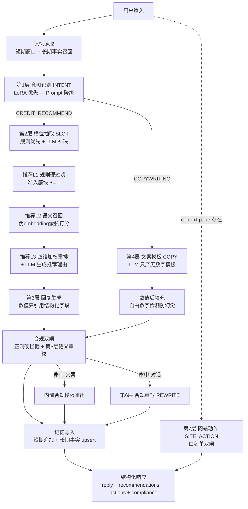

# Agent 推理过程报告：两轮真实对话全链路拆解

> 本报告所有中间结果（意图、槽位、召回、评分、回复、合规结论、模板、成稿、
> 耗时、Token）均来自 **2026-07-25 18:43:41 的一次真实运行**，
> 运行环境为真实大模型 `kimi-for-coding-highspeed`（provider=kimi，
> 网关 agent-gw.kimi.com），未使用任何 Mock / 预置数据。
> 逐层落盘原始文件：`docs/case-study-run.json`（47 KB，9 次 LLM 调用全记录）。
> 文中每个数字都能在该 JSON 中找到出处。

## 摘要

以「华创精密制造有限公司（制造业），需 200 万流动资金周转一年」为客户画像，
连续两轮对话完整走通了平台全部能力层：第 1 轮「请推荐合适产品」触发意图识别
（CREDIT_RECOMMEND）→ 双通道槽位抽取（规则抽出金额/用途，LLM 补出期限/职业）
→ 三层推荐（规则硬过滤 8→1、语义召回、四维加权重排，Top1 税易贷综合分 0.589）
→ 合规双闸放行 → 写入 3 条长期事实；第 2 轮「把推荐的 Top1 写成朋友圈文案」
通过长期记忆事实「最近推荐产品=税易贷」完成跨轮指代消解，LLM 只产出无数字
模板、全部数值由产品库后填充（自由数字检测 0 命中），经正则+语义双闸后输出
成稿。两轮共 9 次 LLM 调用，合计 7983 tokens，端到端 45.1s + 64.4s。

## 案例背景卡

| 项 | 值 |
|----|----|
| 客户画像 | 华创精密制造有限公司（制造业），需 200 万流动资金周转一年 |
| 第 1 轮输入 | 「我们是制造业企业，需要200万流动资金周转一年，请推荐合适产品」 |
| 第 2 轮输入 | 「把推荐的Top1写成朋友圈营销文案」（同 session） |
| LLM | kimi-for-coding-highspeed（`LLM_PROVIDER=kimi`，temperature=1.0，max_tokens=2048） |
| 意图路由 | Prompt 路由（LoRA 模型目录不存在，自动降级，backend=`prompt_fallback`） |
| 记忆后端 | 内存降级后端（memory+memory，同进程内两轮回话真实共享） |
| 产品库 | 8 个在售产品（信享贷/薪易贷/极速信用贷/学子助学贷/兴业经营贷/税易贷/安居房抵贷/车易贷） |
| 评分权重 | 额度 0.30 / 利率 0.30 / 期限 0.20 / 速度 0.20，语义融合权重 0.25 |

## 全链路架构图



---

# 第 1 轮：授信推荐全链路实录

> 输入：「我们是制造业企业，需要200万流动资金周转一年，请推荐合适产品」
> 端到端 45.05s（pipeline 40.78s + 网站动作 4.27s），5 次 LLM 调用。

## 1.1 记忆读取（memory.read，0.12ms）

**真实输出**：`history_len=0，facts=[]，inherited_slots={}`（新会话，冷启动）。

**设计解读**：分层记忆（Redis 短期窗口 + PGVector 长期事实）在每轮最开始读取，
保证后续节点都能拿到跨轮上下文。本轮是首轮，全部为空——这正是第 2 轮
指代消解的对照基线。对应简历卖点：**分层记忆架构**。

## 1.2 意图识别 INTENT（intent.route，4235.76ms）

**真实输入**：用户原句（见上）。
**真实输出**（LLM 调用 #1，594+147=741 tokens）：

```json
{"intent": "CREDIT_RECOMMEND", "reason": "给出企业条件求产品推荐"}
```

路由后端 `prompt_fallback`：LoRA 微调模型目录不存在，自动降级 Prompt 路由
（留痕原文：「kimi: prompt 路由；LoRA 不可用（模型目录不存在:
models\intent-lora-merged），已降级 Prompt 路由」）。

**设计解读**：意图层采用「小模型直出优先、Prompt 兜底」的双轨制——LoRA 在时
延迟可压到毫秒级，不在时行为完全一致、只多一次 LLM 调用。降级不是异常而是
设计态，`intent_detail` 全程留痕。对应简历卖点：**LoRA 意图路由 + 无缝降级**。

## 1.3 槽位抽取 SLOT——双通道互补的真实样本（slots.extract，5954.26ms）

**真实输出**（规则通道 vs 双通道合并，JSON 出处 `turns[0].stages.slots`）：

| 槽位 | 规则通道 | 合并后（+LLM 补缺） | 谁抽到的 |
|------|----------|--------------------|----------|
| amount | 2,000,000 元 | 2,000,000 元 | 规则（「200万」正则） |
| purpose | 周转 | 周转 | 规则（用途词典命中） |
| term_months | —（未命中） | **12** | LLM（「一年」是中文数词，规则正则不覆盖） |
| occupation | —（未命中） | **企业主** | LLM（从「制造业企业」推断身份） |

LLM 通道原始输出（调用 #2，397+212=609 tokens）：

```json
{"amount":2000000,"term_months":12,"purpose":"周转","occupation":"企业主"}
```

**设计解读**：这是双通道设计最有说服力的真实样本——规则通道毫秒级、可解释、
可审计，但「一年」这类中文数词和「制造业企业→企业主」这类身份推断超出
正则能力；合并纪律是「**规则优先、LLM 只补缺不覆盖**」，既保住可解释性底线，
又拿到模型的语义理解红利。对应简历卖点：**规则+LLM 双通道槽位抽取**。

## 1.4 三层推荐（recall 0.48ms + rerank 17872.59ms）

### 第 1 层：规则硬过滤（8 → 1，真实逐个淘汰原因）

语义召回查询文本（槽位拼接增强）：
`我们是制造业企业，需要200万流动资金周转一年，请推荐合适产品 周转 企业主 借款200万 期限12个月`

| 产品 | 判定 | 真实淘汰原因（原文） |
|------|------|---------------------|
| **税易贷** | ✅ 通过 | — |
| 信享贷 | ❌ | 期望金额200万超出最高额度30万；用途"周转"不在准入用途['消费','装修','教育','旅游','医疗']内 |
| 薪易贷 | ❌ | 期望金额200万超出最高额度20万 |
| 极速信用贷 | ❌ | 期望金额200万超出最高额度5万 |
| 学子助学贷 | ❌ | 期望金额200万超出最高额度8万；用途"周转"不在准入用途['教育','留学']内 |
| 兴业经营贷 | ❌ | 期望金额200万超出最高额度100万 |
| 安居房抵贷 | ❌ | 用途"周转"不在准入用途['经营','装修','消费']内 |
| 车易贷 | ❌ | 期望金额200万超出最高额度50万；用途"周转"不在准入用途['购车','买车']内 |

**设计解读**：8 个产品只有税易贷同时满足「200 万额度 + 12 个月期限 + 周转用途」。
值得注意的是安居房抵贷——额度期限都够，但准入用途白名单不含「周转」，照样淘汰。
这一层是纯确定性代码，不经过模型：**宁可少推、不可错推**的合规准入底线，
正是金融场景不能交给概率模型的部分。淘汰原因全部留痕，可直接对客解释。

### 第 2 层：语义召回（伪 embedding 降级实现的真实分数）

税易贷语义分 **0.019**（余弦相似度映射到 [0,1]，8 进 1 后唯一候选）。

**设计解读**：0.019 这个低分是**哈希伪 embedding 降级实现的真实边界**——
无 PGVector / 真实向量模型时，接口与分数域保持不变，但区分度有限。
它不掩盖、不粉饰：真实环境把 `hash_embed` 换成 bge/text2vec、把逐条 cosine
换成 PGVector `<=>` 运算符即可，业务代码零改动。

### 第 3 层：四维加权重排（真实评分明细）

税易贷（唯一过线候选）四维明细（JSON 出处 `turns[0].stages.rerank`）：

| 维度 | 得分 | 说明 |
|------|------|------|
| 额度匹配度 amount | 0.7750 | 300万上限/200万诉求=1.5 倍，落在 [1,3] 理想区间 |
| 利率优惠度 rate | 0.9306 | 最低年化 3.85% 在全库区间中接近最优 |
| 期限灵活度 term | 1.0000 | 最长 36 个月 ≫ 12 个月诉求 |
| 审批速度 speed | 0.3357 | 48 小时在全库中偏慢 |
| **业务分** | **0.7788** | 0.3×0.775+0.3×0.9306+0.2×1.0+0.2×0.3357 |
| 语义分 | 0.0190 | 见第 2 层 |
| **综合分 final** | **0.5889** | 0.75×0.7788 + 0.25×0.019 |

LLM 推荐理由（调用 #3，222+699=921 tokens，17.87s——reasoning 模型思考开销
主要在 completion tokens）：
「税易贷以企业纳税信用为基础，契合您作为企业主经营周转的需求。」

**设计解读**：额度分的设计尤其值得说明——它奖励「贴合度」而非「富余度」，
500 万房抵贷服务 200 万诉求属于「用大炮打蚊子」，超出 3 倍后线性衰减。
LLM 在重排层只做解释、不改顺序，评分是不可逾越的底线。

## 1.5 回复生成（真实输出全文）

```
根据您的情况，为您推荐以下产品（按综合评分排序）：
  Top1 税易贷（经营贷）综合分 0.589
      额度10-300万，年化3.85%-6.5%，6-36个月，最快48小时审批
      推荐理由：税易贷以企业纳税信用为基础，契合您作为企业主经营周转的需求。
以上额度和利率均以最终审批为准。
```

**设计解读**：所有数值（10-300万 / 3.85%-6.5% / 6-36个月 / 48小时）全部来自
产品库结构化字段的模板化渲染，模型只贡献推荐理由那句话——数值通道从架构上
杜绝报价幻觉。固定收尾「以最终审批为准」是合规话术锚点。

## 1.6 合规双闸（regex 0.03ms + semantic 12716.52ms）

**真实结论**：`blocked=false`，正则命中 0 条；语义审核 `method="skipped"`——
对话回复在真实 LLM 模式下**不启用伪向量比对**（伪向量锚定的是违规营销话术，
对顾问式对话误伤面大），只做 LLM 复核。复核原始输出（调用 #4，
533+560=1093 tokens）：`{"verdict": "PASS", "reason": "排序标签中性，内容客观合规"}`。

**设计解读**：合规策略按内容类型分路——对话回复「宁缺勿滥」（LLM 复核失败
默认放行），营销文案「宁严勿宽」（伪向量+LLM 双闸全上）。这套分路策略源自
真实踩坑（详见 prompt-design.md「Top1 误拦事件」）。对应简历卖点：
**分场景双重风控**。

## 1.7 网站动作 SITE_ACTION（4274ms，独立于主管线）

**真实输出**（调用 #5，553+124=677 tokens）：

```json
{"actions": [{"type": "recommend", "params": {}}]}
```

**设计解读**：与 INTENT 层分工——INTENT 判对话意图驱动回复管线，本层判操作
意图驱动前端页面动作。请求带 `context.page` 才触发，白名单双闸（提示词约束 +
代码 sanitize），失败返回 [] 绝不影响主链路。对应简历卖点：
**语义→动作的白名单三闸设计**。

## 1.8 记忆写入（memory.write，0.21ms）

**真实写入**：`{"借款用途": "周转", "意向额度": "200万", "最近推荐产品": "税易贷"}`。

**设计解读**：事实抽取只在推荐类意图下启用（咨询/闲聊中的品类词会产生噪声
事实）；「最近推荐产品」是专门为跨轮指代准备的事实键——第 2 轮的「Top1」
就靠它消解。

---

# 第 2 轮：跨轮指代消解 + 防幻觉文案生成

> 输入：「把推荐的Top1写成朋友圈营销文案」（同 session）
> 端到端 64.42s（pipeline 44.96s + 网站动作 19.46s），4 次 LLM 调用。

## 2.1 跨轮记忆命中「Top1」指代

**记忆读取真实输出**（memory.read，0.30ms）：
- `history_len=2`（第 1 轮 user+assistant 两条）；
- 长期事实召回 3 条，全部来自第 1 轮写入：

| fact_key | fact_value | 召回相似度 |
|----------|-----------|-----------|
| 意向额度 | 200万 | 0.0871 |
| **最近推荐产品** | **税易贷** | 0.0871 |
| 借款用途 | 周转 | -0.0542 |

- 槽位继承：`{amount: 2000000, purpose: "周转"}`（从上一轮用户原话再抽取）。

**指代消解链路**：「把推荐的Top1写成朋友圈营销文案」这句话本身不含任何产品名
（`_find_products_by_text` 匹配不到「Top1」），意图路由到 COPYWRITING 后，
`_resolve_product` 按「本轮重排 Top1 → 长期记忆"最近推荐产品" → 文本名称匹配
→ 兜底」的顺序解析——本轮无重排结果，**第二条命中：长期事实
「最近推荐产品=税易贷」→ 产品库精确匹配 → 锁定税易贷**。

**设计解读**：指代消解没有依赖模型去"猜"Top1 是什么，而是把上一轮的结构化
结果显式落成事实、这一轮显式读回——确定性链路，可审计、可测试。召回相似度
（0.0871 / -0.0542）同样暴露了伪 embedding 的区分度边界，真实环境换
bge + PGVector 即可。对应简历卖点：**分层记忆驱动的跨轮指代消解**。

## 2.2 意图识别（intent.route，2385.06ms）

LLM 调用 #6（587+61=648 tokens）：
`{"intent": "COPYWRITING", "reason": "要求生成朋友圈营销文案"}`

## 2.3 模板 + 后填充：防数值幻觉的逐字对照（node.copywriting，25179.74ms）

**LLM 原始模板**（调用 #7，300+1077=1377 tokens，25.18s）——契约要求只输出
无数字模板、数值位用白名单槽位占位：

```
【{product_name}】以税定贷，额度至高{max_amount}，利率低至{rate_min}，{min_term}-{max_term}个月灵活周期，快至{approval_hours}小时审批。纳税良好，融资无忧。
```

**自由数字检测**：`free_numbers_found=[]`——模型本轮守规矩（若越权生成数字，
整模板拒用、换内置安全模板，并留痕 `copywriting.hallucination_blocked`）。

**后填充数据**（全部来自产品库结构化字段）：

| 槽位 | 填充值 | 来源 |
|------|--------|------|
| {product_name} | **税易贷** | product.name |
| {max_amount} | **300万** | product.max_amount |
| {rate_min} | **3.85%** | product.annual_rate_min |
| {min_term}-{max_term} | **6-36** | product.min/max_term_months |
| {approval_hours} | **48** | product.approval_hours |

**最终成稿**（render_ok=true）：

```
【税易贷】以税定贷，额度至高300万，利率低至3.85%，6-36个月灵活周期，快至48小时审批。纳税良好，融资无忧。
*具体额度、利率及审批结果以银行最终审核为准，请理性借贷。
```

**设计解读**：这是「模板+数据后填充」机制的逐字证据——模型负责文采
（「以税定贷」「纳税良好，融资无忧」），代码负责数值。哪怕模型幻觉出
"利率低至 2.8%"，`find_free_numbers` 也会拦下整版模板。营销文案的每一个
数字都可追溯到产品库字段。对应简历卖点：**模板填充机制杜绝数值幻觉**。

## 2.4 合规双闸（文案场景：宁严勿宽，双闸全上）

**真实结论**：`blocked=false`；正则命中 0 条；语义审核
`method="hash-embedding"`（文案场景启用伪向量比对违规样本库，0 命中），
LLM 复核（调用 #8，500+701=1201 tokens）：
`{"verdict": "PASS", "reason": "客观介绍产品且有免责声明"}`。

**设计解读**：与第 1 轮对话回复的 `method="skipped"` 形成真实对照——同一段
审核代码，按内容类型自动分路：广告投放场景宁可误拦（命中则围绕原产品用
内置合规模板重出一版），顾问对话宁缺勿滥。

## 2.5 网站动作 + 记忆写入

SITE_ACTION 真实输出（调用 #9，546+170=716 tokens，19.46s）：

```json
{"actions": [{"type": "generate_copy", "params": {"channel": "朋友圈"}}]}
```

模型从「朋友圈营销文案」中抽出渠道参数（product_name 未给——称谓抽取纪律，
模糊匹配是前端执行器职责）。本轮记忆写入 `facts_written={}`——文案意图下
不做事实抽取，防噪声入库。

---

# 关键设计决策复盘表

| 决策 | 机制 | 本次真实运行中的证据 | 防什么坑 |
|------|------|---------------------|----------|
| 防数值幻觉 | LLM 只产无数字模板 + 自由数字检测 + 产品库后填充 | 模板 5 个槽位全部来自产品库，`free_numbers=[]` | 模型编造利率/额度，金融合规事故 |
| 分场景合规 | 文案双闸宁严勿宽 / 对话 LLM 单闸宁缺勿滥 | T1 `method=skipped` vs T2 `method=hash-embedding` | 一刀切误拦正常对话 / 放水违规广告 |
| 降级策略 | 每层独立降级：LoRA→Prompt、PGVector→伪embedding、Redis→内存、LLM 故障→确定性兜底 | `prompt_fallback` 留痕、语义分 0.019 的诚实暴露 | 单点故障全站崩溃；演示环境跑不起来 |
| 白名单三闸 | 动作提示词约束 → client sanitize → 前端执行器 | 两轮动作均一次命中白名单（recommend / generate_copy） | 模型幻觉出危险动作（删数据/越权跳转） |
| 规则优先 LLM 补缺 | 槽位合并纪律：规则已填不被覆盖 | 「一年」规则漏抽、LLM 补 12；金额以规则为准 | 模型篡改可审计的确定结果 |
| 评分是底线 | LLM 只解释不改序，交换幅度 ±1 | 推荐理由契合画像但 Top1 顺序由公式决定 | 模型把低分产品顶到首位 |

---

# 附录 A：Span 耗时表（两轮完整）

| Span | 第 1 轮 (ms) | 第 2 轮 (ms) |
|------|-------------|-------------|
| memory.read | 0.12 | 0.30 |
| intent.route | 4235.76 | 2385.06 |
| slots.extract | 5954.26 | — |
| recall.two_stage | 0.48 | — |
| rerank.business | 17872.57 | — |
| node.copywriting | — | 25179.74 |
| compliance.regex | 0.03 | 0.01 |
| compliance.semantic | 12716.52 | 17389.33 |
| memory.write | 0.21 | 0.07 |
| **pipeline 合计** | **40780** | **44955** |
| site_actions（管线外） | 4274 | 19461 |
| **端到端** | **45054** | **64416** |

耗时分布解读：LLM 调用占 99.9%（memory/recall/regex 均在亚毫秒级），其中
reasoning 模型的"思考"占大头——`explain_recommendation` 单次 17.9s、
`gen_copy_template` 单次 25.2s，completion tokens 中相当比例是思考 token。

# 附录 B：9 次 LLM 调用 Token 消耗明细

| # | 层 | 耗时(s) | prompt | completion | total | finish |
|---|----|---------|--------|------------|-------|--------|
| 1 | classify_intent（T1） | 4.24 | 594 | 147 | 741 | stop |
| 2 | extract_slots（T1） | 5.95 | 397 | 212 | 609 | stop |
| 3 | explain_recommendation（T1） | 17.87 | 222 | 699 | 921 | stop |
| 4 | review_compliance（T1 对话） | 12.72 | 533 | 560 | 1093 | stop |
| 5 | extract_site_actions（T1） | 4.27 | 553 | 124 | 677 | stop |
| 6 | classify_intent（T2） | 2.39 | 587 | 61 | 648 | stop |
| 7 | gen_copy_template（T2） | 25.18 | 300 | 1077 | 1377 | stop |
| 8 | review_compliance（T2 文案） | 17.39 | 500 | 701 | 1201 | stop |
| 9 | extract_site_actions（T2） | 19.46 | 546 | 170 | 716 | stop |
| | **合计** | **109.5** | **4232** | **3751** | **7983** | |

9 次调用全部 `finish_reason=stop`、零重试、零降级。

# 出处声明

- 原始落盘：`docs/case-study-run.json`（运行元信息 / 9 次 LLM 调用完整
  messages 与输出 / 两轮各层 stage 捕获 / span 明细 / token usage）；
- 运行驱动为一次性脚本（已删除），捕获方式为猴子补丁，不修改任何生产代码；
- 运行入口与 `api_server.handle_chat` 同源：`run_turn` + `extract_site_actions`；
- 报告数字与 JSON 一致性抽查口径：综合分 0.5889 = 0.75×0.7788+0.25×0.019；
  token 合计 7983 = 各调用 total_tokens 之和。
