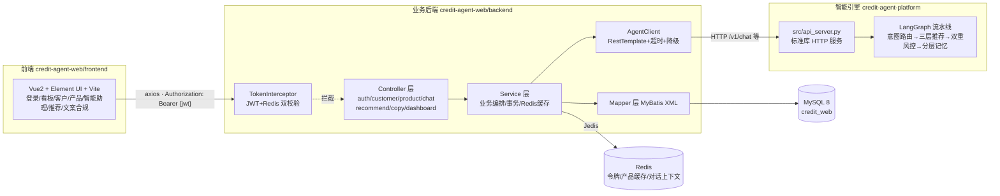

# credit-agent-web · 智能信贷营销与咨询平台（Web 业务系统）

基于 **经典 XML 配置版 SSM（Spring 5.3 + SpringMVC + MyBatis 3.5）+ Redis + Vue2 + Element UI**
的企业级前后端分离信贷业务系统，将 `credit-agent-platform` 的 Python 智能引擎
（三层推荐 / 分层记忆 / 双重风控 / 意图路由）接入真实业务流程：
登录鉴权、客户管理、产品管理、智能对话、推荐记录、营销文案与合规审核、数据看板。

## 系统架构（三层进程）



## 目录结构

```
credit-agent-web/
├── README.md                  # 本文件
├── start-dev.bat              # Windows 一键启动引导（分步拉起三端）
├── docs/
│   └── deployment-guide.md    # 生产部署：Tomcat war / MySQL / Redis / nginx
├── mock-backend/
│   └── server.py              # 演示模式 Mock 后端（纯标准库，内存数据，桥接真 Agent）
├── backend/                   # SSM 业务后端（Maven WAR）
│   ├── pom.xml                # spring5.3/mybatis3.5/druid/jedis/jjwt/logback
│   ├── sql/init.sql           # 建库建表 + 种子数据（admin/123456、8个产品）
│   └── src/main/
│       ├── java/com/credit/web/
│       │   ├── common/        # Result统一响应/分页/全局异常/CorsFilter
│       │   ├── controller/    # 8个控制器（REST 端点）
│       │   ├── service(+impl)/# 8个服务（认证/客户/产品/对话/推荐/文案/看板/用户）
│       │   ├── mapper/        # 9个Mapper接口
│       │   ├── entity/ dto/   # POJO 与请求体
│       │   ├── interceptor/   # TokenInterceptor（JWT签名+Redis存在性双校验）
│       │   ├── agent/         # AgentClient（调Python，超时+失败降级）
│       │   └── util/          # JwtUtil/PasswordUtil(MD5盐值)/RedisUtil/LoginContext
│       ├── resources/
│       │   ├── applicationContext.xml  # 数据源/SqlSessionFactory/事务/JedisPool/RestTemplate
│       │   ├── spring-mvc.xml          # Controller扫描/JSON/拦截器
│       │   ├── mybatis-config.xml      # 驼峰映射等
│       │   ├── jdbc.properties         # 全部外部配置集中于此
│       │   ├── logback.xml
│       │   └── mapper/                 # 9个Mapper XML（SQL全部在此）
│       └── webapp/WEB-INF/web.xml      # 监听器/编码过滤器/CORS/DispatcherServlet
└── frontend/                  # Vue2 + Element UI（Vite 构建）
    ├── package.json  vite.config.js  index.html
    ├── scripts/dev-all.js     # 演示模式一键启动（Agent + Mock + Vite 三进程）
    └── src/
        ├── api/               # axios封装（token注入/401跳登录）+ 端点定义
        ├── router/ store/     # 路由守卫 + vuex登录态
        ├── layout/Layout.vue  # 深色侧边栏+顶栏主布局
        └── views/             # login/dashboard/customer/product/chat/recommend/copy/profile
```

## 演示模式（无需 JDK / MySQL / Redis，一键三进程）

仓库内置一个**纯 Python 标准库的 Mock 后端**（`mock-backend/server.py`），
完整实现 SSM 后端的全部 REST 端点（内存数据、种子与 `init.sql` 对齐），
并把 `/chat/send`、`/copy/generate` 桥接到真实的 Python 智能引擎。
只要 **Node 16+ 和 Python 3.10+** 就能把全站跑起来：

```bash
cd frontend
npm install
npm run dev          # 一键拉起：Agent(:8000) + Mock后端(:8080/credit-web) + Vite(:5173)
npm run dev -- --port 7100   # 端口被占用时透传给 vite
```

- 三个进程由 `frontend/scripts/dev-all.js` 统一管理，`Ctrl+C` 会清理整棵进程树；
  环境变量 `CREDIT_PYTHON` / `CREDIT_AGENT_URL` / `CREDIT_MOCK_PORT` 可覆盖默认值。
- Mock 后端与真后端**同一契约**：统一 `{code, message, data}`、401 走 HTTP 200、
  同样剥离 `/credit-web` 上下文前缀，因此前端在两种模式间**零改动切换**；
  Agent 不可达时按与 Java `AgentClient` 相同的纪律降级（对话变友好提示、文案返回
  业务错误、看板显示「Agent 离线」），其余功能不受影响。
- 内存数据重启即重置；演示账号同为 `admin / 123456`、`manager01 / 123456`。
- 已实测（Windows，Node 24）：登录 → 智能对话（意图+四维评分推荐）→ 文案生成 →
  看板聚合 → 401 行为 → 八个只读端点，7 项端到端检查全部通过。

切换到**真 SSM 模式**：按下方「快速开始」启动 MySQL/Redis/`mvn tomcat7:run` 后，
前端改用 `npm run dev:vite`（只起 Vite，不拉起 Mock 与 Agent）即可。

## 本地编译验证（SSM 后端）

已在本机完成真实编译与打包（2026-07-24）：

| 项 | 版本/结果 |
|----|-----------|
| JDK | Oracle JDK **26.0.2**（`C:\Program Files\Java\jdk-26.0.2`，source/target 保持 1.8） |
| Maven | Apache Maven **3.9.16**（解压于 `../../.tools/`，本地仓库 `../../.m2/repository`） |
| `mvn -DskipTests compile` | **BUILD SUCCESS**，55 个 Java 文件 → 57 个 class，零编译错误 |
| `mvn -DskipTests package` | **BUILD SUCCESS**，产出 `backend/target/credit-web.war`（约 20.7 MB，含 9 个 Mapper XML、全部 Spring 配置与 28 个依赖 jar） |

说明：maven-compiler-plugin 3.13.0 与 maven-war-plugin 3.4.0 在 JDK 26 下工作正常，
无需改动任何依赖坐标或 Java 源码。复现命令：

```bash
export JAVA_HOME="C:\Program Files\Java\jdk-26.0.2"
mvn -DskipTests package    # 首次建议配置阿里云镜像加速依赖下载
```

## 快速开始（开发环境）

前置：JDK 8+、Maven 3.6+、Node 16+、Python 3.10+、MySQL 8、Redis 5+。
（无 MySQL/Redis 时 Python 引擎仍可独立演示；后端需要二者才能完整运行。）

```bash
# 0) 数据库初始化
mysql -uroot -p < backend/sql/init.sql

# 1) 启动 Redis（默认 localhost:6379，无密码）

# 2) 启动 Python 智能引擎（端口 8000，零第三方依赖）
cd ../credit-agent-platform
python src/api_server.py --port 8000

# 3) 启动 SSM 后端（端口 8080，上下文 /credit-web）
cd ../credit-agent-web/backend
mvn tomcat7:run          # 开发期一键起（内嵌Tomcat）；或打 war 部署到 Tomcat 9

# 4) 启动前端（端口 5173，/api 代理到 8080/credit-web）
cd ../frontend
npm install
npm run dev:vite       # 只起 Vite（连真 SSM 后端）；npm run dev 会拉起演示模式三进程
```

也可以直接双击 `start-dev.bat` 查看分步引导。

## 演示账号

| 账号 | 密码 | 角色 | 权限差异 |
|------|------|------|----------|
| `admin` | `123456` | 系统管理员 | 全部功能 + 产品增删改 + 用户列表 |
| `manager01` | `123456` | 客户经理 | 客户管理、智能助理、文案生成（产品只读） |

密码存储为 `MD5(盐 + 明文)`，盐值随机（`PasswordUtil`）。

## 接口清单（统一 `{code, message, data}`，code=0 成功）

| 方法 | 路径 | 说明 | 鉴权 |
|------|------|------|------|
| POST | `/auth/login` | 登录，签发 JWT（jti 存 Redis，2h） | 放行 |
| POST | `/auth/logout` | 注销（删 Redis 令牌键） | ✓ |
| GET | `/auth/info` | 当前登录用户 | ✓ |
| GET | `/health` | 网站 + Agent 双健康 | 放行 |
| GET | `/dashboard/stats` | 今日对话/推荐、合规通过率、意图分布 | ✓ |
| GET | `/customer/page` | 客户分页（name/phone/occupation 过滤） | ✓ |
| GET/POST/PUT/DELETE | `/customer/{id}` | 客户 CRUD | ✓ |
| GET | `/product/list` | 在售产品（Redis 缓存 10min） | ✓ |
| POST/PUT/DELETE | `/product` | 产品增删改（清缓存） | admin |
| GET | `/system/user/list` `/role/list` | 用户/角色 | admin |
| POST | `/chat/send` | 发送消息 → 调 Agent → 落库消息/推荐记录 → Redis 上下文 | ✓ |
| GET | `/chat/sessions` `/chat/messages` | 会话列表 / 历史消息 | ✓ |
| GET | `/recommend/page` | 推荐记录分页（含四维评分 JSON，可按客户过滤） | ✓ |
| POST | `/copy/generate` | 生成营销文案（模板填充+合规审核+落库） | ✓ |
| GET | `/copy/page` | 文案记录分页（`onlyViolation=true` 仅看违规） | ✓ |

Python 引擎端点（`credit-agent-platform`，端口 8000）：
`GET /health`、`GET /v1/products`、`POST /v1/chat`、`POST /v1/copy/generate`、`POST /v1/compliance/check`。

## 关键设计

- **有状态 JWT**：JWT 签名校验 + Redis `web:token:{jti}` 存在性双重确认，
  注销/踢人即删键，兼顾无状态性能与可吊销性；
- **Agent 故障隔离**：`AgentClient` 所有调用带连接/读取超时，异常时返回
  `available=false` 的友好降级结构 —— Python 服务挂掉，客户/产品/记录等
  功能完全不受影响，看板与顶栏展示「Agent 离线」；
- **Redis 三用途分前缀**：登录令牌 `web:token:*`、产品缓存 `web:product:list`、
  对话上下文 `web:chat:ctx:*`；与 Agent 侧短期记忆 `credit:session:*` 同实例隔离；
- **配置集中**：所有环境相关项（MySQL/Druid/Redis/Agent地址/JWT密钥）集中在
  `backend/src/main/resources/jdbc.properties`，部署只改这一个文件。

## 全站悬浮窗（Copilot 模式）

右下角常驻「南洋智能助手」悬浮球（`frontend/src/components/FloatingAgent.vue`，
挂载于 Layout，登录后全站可用）。它不只是一个聊天窗，而是**语义驱动页面动作**
的 Copilot：用户说一句模糊的话，Agent 在返回对话回复的同时返回一组结构化
网站动作（`actions`），前端执行器校验后逐条执行，并插入回执消息。

**链路**：悬浮窗 `/chat/send` 携带 `context:{page}` → 后端透传 Agent →
Agent 第 7 层提示词 `site_action_messages` 抽取动作（仅当 `context.page` 存在，
否则 `actions=[]` 对既有管线零影响）→ 响应 `{reply, recommendations, actions}`
→ 前端执行器（白名单校验）执行并反馈。

**动作白名单**（Agent 提示词约束 → `client.py` 代码白名单 → 前端执行器，三道闸）：

| 动作 type | 参数 | 前端行为 |
|-----------|------|----------|
| `navigate` | `path`（限站内 7 条路由） | `router.push` 打开页面 |
| `search_customer` | `keyword` | 跳企业客户页并按关键词筛选（Vuex 通道传递） |
| `view_customer` | `name`（原话称谓，如"华创"） | `customerPage` 模糊匹配 → 打开客户详情弹窗 |
| `open_product` | `name` | 跳信贷产品页并高亮目标行、滚动到位 |
| `generate_copy` | `product_name?` `channel?` | 匹配产品编码 → 调文案生成 → 成稿卡插入消息流 |
| `show_stats` | — | 拉取看板统计 → 迷你统计卡插入消息流 |
| `recommend` | — | 推荐卡随 `recommendations` 展示（三维评分条） |

**设计要点**：企业名只抽取原话称谓，模糊匹配到完整实体是前端职责（Agent 无
客户库）；动作执行后插入回执（"已为您打开「华创精密制造有限公司」的客户详情"）；
面板关闭时收到回复亮未读点；文案生成等重管道动作带行内加载条，不阻塞输入。

## 相关文档

- 生产部署：[docs/deployment-guide.md](docs/deployment-guide.md)
- 智能引擎架构：[../credit-agent-platform/docs/implementation-guide.md](../../credit-agent-platform/docs/implementation-guide.md)
